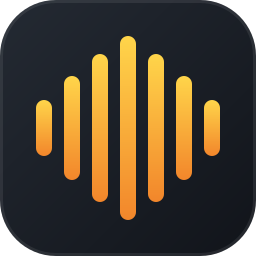

<p align="center"></p>

<h1 align="center">vowen-linux</h1>

<p align="center">
  <a href="https://github.com/raphaelbleier/vowen-linux/actions/workflows/ci.yml"></a>
  <a href="https://github.com/raphaelbleier/vowen-linux/actions/workflows/engines.yml"></a>
  <a href="https://github.com/raphaelbleier/vowen-linux/actions/workflows/upstream.yml"></a>
  <br>
  
  
  <a href="https://github.com/raphaelbleier/vowen-linux/releases"></a>
  
</p>

Unofficial Linux build kit for [Vowen](https://vowen.ai), the voice dictation and meeting-notes app for macOS and Windows.

This repository contains **no Vowen code**. `install.sh` downloads the official macOS release from vowen.ai on your machine, checks its SHA-256, and converts it into a Linux app:

- Electron 38 for Linux instead of the macOS runtime
- Linux replacements for Vowen's native macOS helpers (audio capture, text insertion, global hotkeys, media pause, mic-in-use detection)
- whisper.cpp, Parakeet and speaker diarization engines built for Linux (CPU, Vulkan, CUDA)
- small patches so Linux takes the same code paths as Windows

Vowen's licensing is untouched: Free works as on macOS, Pro needs a Vowen license. Not affiliated with or endorsed by Vowen.

## Install

Requirements: x86_64, Node.js ≥ 20, `7z` (7zip), `curl`, `unzip`, `python3`, PipeWire or PulseAudio (`pactl`, `parec`), `wl-clipboard` (Wayland) or `xclip` (X11).

```sh
git clone https://github.com/raphaelbleier/vowen-linux
cd vowen-linux
./install.sh
```

The installer puts Vowen in `~/.local/share/vowen-linux`, the launcher in `~/.local/bin/vowen-linux`, and adds a menu entry and the `vowen://` link handler. Re-run it to update.

One-time permissions (the installer prints these when needed):

```sh
sudo usermod -aG input $USER    # global hotkeys + auto-paste; log out and in afterwards
```

Members of the `input` group can read keyboard input; that is what a global push-to-talk hotkey requires.

## Status

Work in progress. Tested on Ubuntu 26.04, KDE Plasma 6 (Wayland), NVIDIA RTX 3060. "Tested" means checked end to end in
the installed app (real hotkey via uinput, audio through a virtual microphone, text pasted into a window); "implemented"
means built and unit-tested but not yet driven through the app.

| Feature | How it works on Linux | Status |
|---|---|---|
| Push-to-talk hotkey (hold Ctrl+Shift) | `vowen-input`: evdev reader + uinput keyboard, works on Wayland and X11 | tested |
| Microphone recording | `audio-recorder`: PipeWire/Pulse via `parec` | tested |
| Text insertion | `text-writer`: clipboard + Ctrl+V through `vowen-input` (fallback `ydotool`, `xdotool`) | tested |
| Paste into terminals (Ctrl+Shift+V) | active window from a KWin script (`vowen-activewin`) | tested (Konsole) |
| Whisper models | whisper.cpp 1.8.6, CPU / Vulkan / CUDA backends loaded at runtime | tested (tiny, base, small, large-v3-turbo; CUDA and Vulkan) |
| Parakeet v3, v2, Japanese | ONNX Runtime (`parakeet-cli`) | tested |
| Nemotron EN | sherpa-onnx (`sherpa-asr-cli`) | tested (no punctuation) |
| Nemotron multilingual | sherpa-onnx | tested |
| Parakeet Mandarin | no ONNX export exists | not available (use Nemotron multilingual) |
| Model download / selection | Vowen's own model manager | tested |
| Tray menu | StatusNotifierItem + DBusMenu | tested |
| Settings / onboarding windows | XWayland | tested |
| Quit, logout, crash cleanup | SIGTERM handling, engine servers die with the app | tested |
| Usage statistics | Vowen's JSON store | tested |
| Meeting notes with system audio | default sink monitor via `parec` | tested (mic + system audio, start/stop from the tray) |
| Speaker diarization | sherpa-onnx (`diarize-cli`) | engine tested; in notes it is a Pro feature, not tested |
| Meeting detection (mic in use) | `linux-mic-listener`: `pactl subscribe` | helper tested; Pro feature, not tested in the app |
| Hands-free mode, voice shortcuts, text expansions | Vowen's own logic on top of `vowen-input` | tested |
| Command mode, AI cleanup | needs an AI provider (API key or local LLM) | not tested |
| Dictionary | Vowen's own logic | not tested separately |
| Per-app tones, app picker, browser profiles | `vowen-activewin` (KDE; X11 via xprop; not on GNOME Wayland) | implemented |
| Pause media while dictating | `playback-controller`: MPRIS + `wpctl` | helper tested with an MPRIS player; Pro feature, not tested in the app |
| Screenshots (region, click capture, meetings) | `vowen-screenshot`: spectacle, grim, gnome-screenshot or `import` | tested (capture API, KDE) |
| Command-mode file actions | file manager selection via Ctrl+C and `text/uri-list` | helper tested |
| Open with / `vowen://` links, file transcription | desktop file + argv | tested |
| Stop recording on lock / suspend | ScreenSaver D-Bus signal, logind | tested (simulated lock signal) |
| Autostart, start minimized to tray | XDG autostart | tested |
| Cloud models (OpenAI, Deepgram, ...) and AI features | unchanged from Vowen | should work, not tested |
| Custom shortcuts not leaking into apps | keyboard grab + re-emit, opt-in `VOWEN_SWALLOW=1` | experimental |
| Notch indicator, Share extension, Apple Notes/Reminders connectors | macOS only | not available |
| Automatic updates | Vowen's updater is disabled | re-run `install.sh` |

Start Vowen from the menu or with `vowen-linux`. The launcher is deliberately not called `vowen`: Vowen's Developer settings look for its own `vowen` command-line tool on `PATH`. It also picks the key store (`--password-store`: KWallet on KDE, libsecret on GNOME and others) and adds your login shell's `PATH`, so CLI agents such as Claude Code or Codex in `~/.local/bin` or npm-global are found.

Terminals are detected on KDE and X11 and get Ctrl+Shift+V. Elsewhere, set `VOWEN_PASTE_CHORD=ctrl+shift+v` if you mostly dictate into a terminal.

## Known limitations

- Runs through XWayland (`--ozone-platform=x11`); Electron's native Wayland backend crashes the app.
- Active-app detection needs KDE Plasma or an X11 session; GNOME on Wayland has no API for it.
- Clipboard managers (Klipper) record dictated text.
- Mouse position is only exact on KDE (KWin); other Wayland compositors fall back to XWayland's view.
- Vowen updates need a new release of this kit, because the patches are matched against a specific Vowen version.
- GTX 10xx (Pascal): the released CUDA add-on is built with CUDA 12.9 and includes these cards. A CUDA 13 build from source does not; build with Vulkan there. With several GPUs, pick one with `CUDA_VISIBLE_DEVICES` or `GGML_VK_VISIBLE_DEVICES`.
- Pro features (diarization in notes, meeting detection, media pause, chat with notes) behave as on macOS: they need a Vowen Pro license.

## Updating to a new Vowen release

The `upstream` workflow checks Vowen's update feed every day. When a new version is out, it downloads it on the runner,
runs every patch against it and opens an issue listing the patches that no longer match, with the line where each one's
code moved and the `versions.env` lines to bump. Local equivalent:

```sh
scripts/check-upstream.sh            # newest release from the feed
scripts/check-upstream.sh "" 0.5.9   # a specific release
```

Patches tolerate the obfuscator renaming local variables and shifted indentation (see `patches/apply.mjs`), so
usually only patches whose surrounding code really changed need work. After the patches apply, test the app end to
end: a new Vowen version can change behaviour no patch covers.

## Layout

```
install.sh            download, verify, deobfuscate, patch, assemble, install
patches/              Linux patches, applied to the deobfuscated bundle (each must match exactly once)
runtime/bootstrap.js  Linux entry point (autostart support), then loads Vowen
helpers/              Linux replacements for Vowen's native helpers (Python, stdlib only)
shims/                drop-in replacement for uiohook-napi backed by vowen-input
engines/              build scripts for whisper.cpp, parakeet-cli, diarize-cli
packaging/            desktop integration, AppArmor profile, udev rule
tests/                helper protocol tests
```

## Third-party licenses

See [NOTICE](NOTICE) for the engines, npm packages and speech models (Parakeet is CC-BY-4.0, Nemotron EN is under the NVIDIA Open Model License).

The logo is this project's own and not Vowen's.

## License

The code in this repository is MIT licensed. Vowen itself is proprietary software of its author and is downloaded from vowen.ai at install time.
